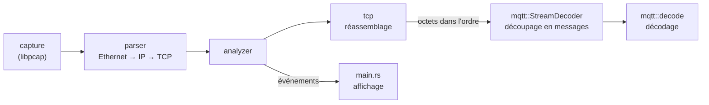

# rnifler

*rnifler* vient de « renifleur », la traduction française de *sniffer*, avec
le **r** de Rust.

[](https://github.com/MkDriss/rnifler/actions/workflows/test.yaml)

Sniffer **défensif** pour MQTT 3.1.1, écrit en Rust : il capture le trafic
d'un broker, reconstitue les flux TCP et décode chaque message en clair
(connexions, publications, abonnements, acquittements).

Le décodage est écrit à la main à partir de la spécification OASIS, sans
bibliothèque MQTT, et chaque violation de la spécification est signalée avec
la référence de l'exigence concernée.

```text
$ rnifler --read capture.pcap
[*] Lecture de capture.pcap | filtre BPF : "tcp port 1883"
[*] Checksums non vérifiés (fichier : précise --local-ip, ou --checksums all si la capture vient d'une machine tierce)
[   0.000000] 127.0.0.1:45892 -> 127.0.0.1:1883  ouverture du flux (SYN)
[   0.000013] 127.0.0.1:1883 -> 127.0.0.1:45892  ouverture du flux (SYN)
[   0.000047] 127.0.0.1:45892 -> 127.0.0.1:1883  MQTT CONNECT client_id="actionneur" clean_session=1 keep_alive=60s user="admin" pass=<masqué, 4 octets> will=-
[   0.000427] 127.0.0.1:1883 -> 127.0.0.1:45892  MQTT CONNACK code=0 (accepté) session_present=0
[   0.000451] 127.0.0.1:45892 -> 127.0.0.1:1883  MQTT PUBLISH topic="labo/actionneur" qos=1 retain=0 dup=0 id=1 payload="ON"
[   0.000463] 127.0.0.1:1883 -> 127.0.0.1:45892  MQTT PUBACK id=1
[   0.000472] 127.0.0.1:45892 -> 127.0.0.1:1883  MQTT DISCONNECT
[   0.000475] 127.0.0.1:45892 -> 127.0.0.1:1883  fermeture du flux (FIN)
[   0.000633] 127.0.0.1:1883 -> 127.0.0.1:45892  fermeture du flux (FIN)
[*] Fin du fichier : 13 trame(s) lue(s)
```

*Sortie réelle : capture enregistrée avec `tcpdump -w` pendant un
`mosquitto_pub -q 1 -u admin -P 1234` contre un broker Mosquitto local.*

> **Usage légitime uniquement.** Ce logiciel est destiné à observer le trafic
> de sa propre infrastructure. Capturer le trafic d'un réseau sans
> autorisation peut être illégal.

## Fonctionnalités

- **Capture** en direct (libpcap, filtre BPF exécuté dans le noyau) ou lecture
  d'un fichier `.pcap` (`--read`), sans privilège dans ce second cas.
- **Réassemblage TCP** par sens de connexion : messages répartis sur plusieurs
  segments, retransmissions, trous, connexions déjà ouvertes au démarrage.
- **Décodage des 14 types de paquets MQTT 3.1.1**, avec détection détaillée
  des violations de la spécification (flags réservés, longueurs mensongères,
  QoS interdite, UTF-8 invalide...).
- **Résistance aux données hostiles** : neutralisation des séquences
  d'échappement à l'affichage (CWE-150), mots de passe masqués par défaut,
  mémoire bornée, vérification des checksums contre l'insertion.

## Installation

Prérequis : Rust **1.88** ou plus récent ([rustup](https://rustup.rs)), et la
bibliothèque libpcap avec ses en-têtes.

```bash
sudo dnf install libpcap-devel        # Fedora
sudo apt install libpcap-dev          # Debian, Ubuntu, Raspberry Pi OS

git clone https://github.com/MkDriss/rnifler.git
cd rnifler
cargo build --release
```

Des binaires précompilés (x86_64 et arm64) sont attachés à chaque
[release](https://github.com/MkDriss/rnifler/releases), avec leur
empreinte SHA-256. Ils sont compilés sous Ubuntu et liés à la bibliothèque
`libpcap.so.0.8` des distributions Debian et Ubuntu ; sous Fedora, compile
depuis les sources.

### Privilèges

La capture en direct demande la capability `CAP_NET_RAW`. Plutôt que de
lancer tout le programme en root, on peut l'attribuer au seul binaire :

```bash
sudo setcap cap_net_raw=eip target/release/rnifler
```

Elle est perdue à chaque recompilation : il faut alors relancer `setcap`.

## Utilisation

```bash
rnifler -i wlan0                         # capture en direct
rnifler --read capture.pcap              # rejoue un fichier
rnifler --read capture.pcap --local-ip 192.168.1.10
rnifler -i lo --segments --hex           # détail de chaque segment TCP
rnifler -i wlan0 -w captures/            # afficher et enregistrer en pcap
```

| Option | Rôle |
|---|---|
| `-i, --interface` | interface à écouter (`lo` par défaut) |
| `-r, --read` | lit un fichier de capture au lieu d'une interface |
| `-w, --write` | enregistre les trames dans ce dossier, en fichiers pcap horodatés |
| `--write-max-mb` | taille maximale d'un fichier enregistré, en Mio (100 par défaut) |
| `-f, --filter` | filtre BPF, syntaxe tcpdump (`tcp port 1883` par défaut) |
| `-c, --count` | s'arrête après N trames |
| `--segments` | affiche aussi chaque segment TCP |
| `--hex` | affiche le contenu des segments en hexadécimal |
| `--checksums` | `auto` (défaut), `all` ou `off` : voir ci-dessous |
| `--local-ip` | adresse de la machine de capture (répétable) |
| `--show-secrets` | affiche les mots de passe MQTT en clair |
| `--list` | liste les interfaces disponibles |

**Vérification des checksums.** Un segment au checksum invalide est rejeté
par la machine destinataire ; l'analyser quand même permettrait à un attaquant
de faire afficher un faux message (attaque par *insertion*). Mais les paquets
émis par la machine de capture ont souvent des checksums faussés par
l'*offload*, et l'interface loopback ne calcule jamais le checksum TCP. En
mode `auto`, le sniffer vérifie donc les paquets reçus par les adresses de
l'interface, ne vérifie rien sur loopback, et ne vérifie un fichier que si
`--local-ip` est précisé.

**Enregistrement.** Avec `--write`, chaque trame est enregistrée brute, avant
l'analyse, dans des fichiers nommés d'après l'horodatage UTC de leur première
trame, à la milliseconde (`capture-2026-11-05T17-12-30.123Z.pcap`). Un nouveau
fichier commence dès que le fichier courant atteint `--write-max-mb` Mio
(100 par défaut). Une capture MQTT sans TLS contient les identifiants en
clair : le dossier est créé en `0700`, les fichiers en `0600`, et aucun
fichier existant n'est jamais écrasé.

### Scénarios de test rejouables

```bash
cargo run --example scenarios -- scenarios/
cargo run -- --read scenarios/insertion-checksum.pcap --checksums all
```

Huit captures fabriquées reproduisent des situations précises : message coupé,
segment perdu, désordre, paquet malformé, RST forgé, topic piégé, insertion,
connexion déjà ouverte.

## Architecture



La bibliothèque ne fait qu'**observer et signaler** : chaque constat (message
décodé, trou, anomalie, fermeture...) est livré sous forme d'événement à une
fonction fournie par l'appelant. Le binaire `main.rs` se contente de les
afficher, et d'autres outils peuvent réutiliser la bibliothèque telle quelle.

| Module | Rôle |
|---|---|
| `capture` | ouverture d'une interface ou d'un fichier pcap |
| `parser` | découpage zéro-copie Ethernet → IPv4/IPv6 → TCP (`etherparse`) |
| `checksum` | vérification des checksums IPv4 et TCP (RFC 1071) |
| `tcp` | réassemblage par sens de connexion, sans copie |
| `mqtt` | décodage MQTT 3.1.1 et découpage d'un flux en messages |
| `analyzer` | relie les couches et produit les événements |

## Choix de conception et de sécurité

- **Zéro-copie** : topics et payloads sont des emprunts (`&str`, `&[u8]`) dans
  les octets capturés ; seuls les messages à cheval sur plusieurs segments sont
  copiés, dans un tampon borné.
- **Mémoire bornée** contre l'épuisement : 256 flux suivis, 1 Mio par message
  (refusé dès son en-tête), 64 Mio pour l'ensemble des messages incomplets,
  expiration des flux inactifs.
- **Comportement aligné sur Linux** : un RST n'est accepté que si son numéro
  de séquence est exactement celui attendu (RFC 5961), comme le fait le noyau
  du broker ; un RST forgé ne fait donc pas « perdre » une connexion.
- **Affichage sûr** : toute chaîne venue du réseau est neutralisée
  (`str::escape_debug`) pour qu'un client malveillant ne puisse pas effacer ou
  réécrire le terminal.
- **Aucune panique sur des données hostiles** : chaque longueur annoncée est
  vérifiée avant lecture, et une trame malformée est signalée sans arrêter le
  programme.

Les limites connues sont décrites dans [`docs/LIMITATIONS.md`](docs/LIMITATIONS.md),
et les termes techniques, avec leurs sources, dans
[`docs/GLOSSAIRE.md`](docs/GLOSSAIRE.md).

## Tests

```bash
cargo test
```

- **Tests unitaires** sur des trames réelles capturées et sur chaque règle de
  détection de la spécification MQTT (toutes les variantes d'erreur sont
  couvertes).
- **Tests d'intégration** (`tests/replay.rs`) : chaque scénario est écrit dans
  un vrai fichier pcap, relu par libpcap, puis analysé de bout en bout.
- **Test différentiel** du calcul des checksums contre etherparse.
- **Tests de mutation** manuels : chaque protection de sécurité a été
  volontairement désactivée pour vérifier qu'un test échoue.

L'intégration continue (GitHub Actions) lance tous les tests à chaque push.

## Références

- OASIS, *MQTT Version 3.1.1*, 2014.
- RFC 791 (IPv4), RFC 9293 (TCP), RFC 8200 (IPv6), RFC 1071 (checksum
  Internet), RFC 5961 (robustesse de TCP), RFC 7323 (extensions TCP).
- T. H. Ptacek, T. N. Newsham, *Insertion, Evasion, and Denial of Service:
  Eluding Network Intrusion Detection*, 1998.

La liste complète des sources est à la fin du [glossaire](docs/GLOSSAIRE.md).

## Licence

Au choix, sous licence [MIT](LICENSE-MIT) ou [Apache 2.0](LICENSE-APACHE).
